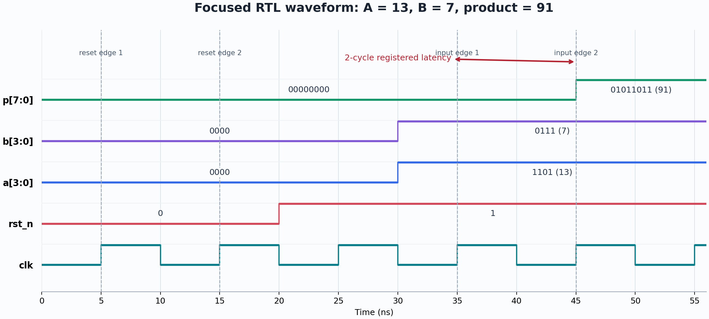
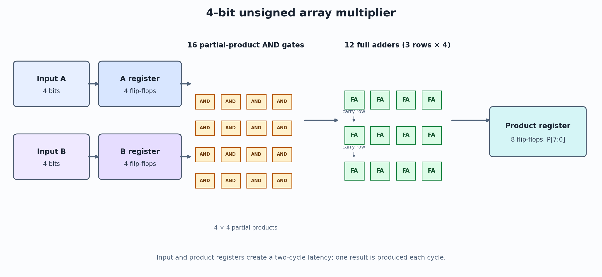

# 4-bit Array Multiplier: RTL to GDSII

## Team

| Team member | Roll number |
| --- | --- |
| Dhruv Bansal | 2023102048 |
| Dataarnoor Singh Oberoi | 2023102047 |

## Design overview

This project implements a registered unsigned 4-bit array multiplier. The RTL
forms 16 partial products, combines them with 12 full adders, registers both
operands, and registers the 8-bit product. The interface has two clock cycles of
latency and accepts one input pair per cycle. The design was checked with an
exhaustive 256-vector testbench, synthesized to SKY130A cells, analyzed with
OpenSTA, and taken through placement, routing, and signoff with LibreLane.

## Part A: RTL and functional verification

From the repository root, compile and run the exhaustive testbench:

```sh
iverilog -g2012 -o sim tb/tb_mult.v rtl/full_adder.v rtl/mult_array.v
vvp sim
```

Expected result:

```text
PASS: 256 vectors checked, 0 errors
```

The simulation writes `mult.vcd`. To inspect it interactively, run:

```sh
gtkwave mult.vcd
```

The waveform and the multiplier block diagram are included below. The waveform
shows reset low for two rising edges, A=13 and B=7 applied, and P=91 at the
second rising edge after the inputs are captured.





For the assigned hand-worked vector, Dhruv Bansal's roll number ends in 8, so
A = 8 + 5 = 13 and B = 7:

```text
       1101  (13)
     x 0111  (7)
     ------
    00001101  pp0
    00011010  pp1, shifted left by 1
    00110100  pp2, shifted left by 2
    00000000  pp3, shifted left by 3
    --------
    01011011  (91)
```

For error detection, temporarily replace the sum expression in
`rtl/full_adder.v` with `assign sum = a ^ b;`, compile and run the same
testbench commands, and observe `FAIL: 256 vectors checked, 95 errors`. Restore
the correct `assign sum = a ^ b ^ cin;` expression before continuing.

## Part B: synthesis and gate-level simulation

Run Yosys from the repository root in the IIC-OSIC-TOOLS environment after
selecting the `sky130A` PDK:

```sh
yosys -c synth/synth.tcl
```

This writes `synth/mult_array_netlist.v` and `synth/mult_array_stat.rpt`.
Synthesis reports 61 mapped cells and 756.976 µm² total cell area. Sixteen
`sky130_fd_sc_hd__dfrtp_1` flip-flops occupy 400.384 µm², or 52.89% of the mapped
area. The most-used cell types are `dfrtp_1` (16), `nand2_1` (7), and `and2_0`
(4); `maj3_1` is tied with `and2_0` at 4 cells.

Run gate-level simulation against the SKY130 functional models:

```sh
CELLS="$PDK_ROOT/sky130A/libs.ref/sky130_fd_sc_hd/verilog"
iverilog -g2012 -DFUNCTIONAL '-DUNIT_DELAY=#1' -o gls \
  tb/tb_mult.v "$CELLS/primitives.v" "$CELLS/sky130_fd_sc_hd.v" \
  synth/mult_array_netlist.v
vvp gls
```

Result: `PASS: 256 vectors checked, 0 errors`.

## Part C: static timing analysis

`sta/sta.tcl` reads the mapped netlist and SKY130A typical-corner Liberty file,
creates the clock, applies 1.0 ns input and output delays, and reports the
critical setup path and worst slack. Run the initial 10 ns analysis:

```sh
CLOCK_PERIOD=10.0 sta -exit sta/sta.tcl > sta/part-c-10ns.log 2>&1
```

The reported register-to-register setup slack is 7.213 ns. Therefore:

```text
Tmin = 10.000 ns - 7.213 ns = 2.787 ns
Fmax = 1000 / 2.787 ns = 358.808 MHz
```

Run again at 2.79 ns (Tmin rounded to 0.01 ns) and save the detailed report:

```sh
CLOCK_PERIOD=2.79 sta -exit sta/sta.tcl > sta/mult_array_timing.rpt 2>&1
```

The second run reports 0.003 ns slack on the critical register-to-register
path. The path starts at `a_reg[1]` (mapped cell `_91_`) and ends at `p[6]`
(mapped cell `_88_`). It contains eight combinational mapped cells between the
launching and capturing flip-flops. The path traverses several full-adder
carry/sum functions; compound library cells combine some of those functions.
The two-cycle registered latency at Tmin is 5.574 ns, and the steady-state
throughput is about 358.808 million results per second.

## Part D: physical design

The floorplan uses the assignment's fixed 150 µm × 150 µm die and absolute
sizing. The initial clock target is 1.2 × 2.787 ns = 3.3444 ns, rounded up to
the next 0.5 ns, or 3.5 ns. The matching clock period is set in both
`pnr/config.json` and `pnr/mult_array_pnr.sdc`. On a setup failure, increase both
period values by 0.5 ns and rerun. Each trial uses the corresponding run tag:

```sh
librelane --manual-pdk --pdk-root "$PDK_ROOT" -p sky130A -f classic \
  --run-tag assignment-150um-3p5ns --jobs 4 pnr/config.json
```

```sh
librelane --manual-pdk --pdk-root "$PDK_ROOT" -p sky130A -f classic \
  --run-tag assignment-150um-4ns --jobs 4 pnr/config.json
```

```sh
librelane --manual-pdk --pdk-root "$PDK_ROOT" -p sky130A -f classic \
  --run-tag assignment-150um-4p5ns --jobs 4 pnr/config.json
```

```sh
librelane --manual-pdk --pdk-root "$PDK_ROOT" -p sky130A -f classic \
  --run-tag assignment-150um-5ns --jobs 4 pnr/config.json
```

```sh
librelane --manual-pdk --pdk-root "$PDK_ROOT" -p sky130A -f classic \
  --run-tag assignment-150um-5p5ns --jobs 4 pnr/config.json
```

```sh
librelane --manual-pdk --pdk-root "$PDK_ROOT" -p sky130A -f classic \
  --run-tag assignment-150um-6ns --jobs 4 pnr/config.json
```

```sh
librelane --manual-pdk --pdk-root "$PDK_ROOT" -p sky130A -f classic \
  --run-tag assignment-150um-6p5ns --jobs 4 pnr/config.json
```

Record each trial in the table after it completes:

| Clock target | Result | Notes |
| ---: | --- | --- |
| 3.5 ns | Failed setup | Slow-corner setup violations |
| 4.0 ns | Failed setup | Slow-corner setup violations |
| 4.5 ns | Failed setup | Slow-corner setup violations |
| 5.0 ns | Failed setup | Worst slow-corner slack was -0.456 ns |
| 5.5 ns | Failed setup | Worst slow-corner slack was -0.149 ns |
| 6.0 ns | Failed setup | Worst slow-corner slack was -0.190 ns |
| 6.5 ns | Passed | Setup, DRC, and LVS signoff completed |

The final run's metrics and GDSII are copied from its `final/` results into the
required root-level deliverables:

```sh
cp pnr/runs/assignment-150um-6p5ns/final/metrics.json pnr/metrics.json
cp pnr/runs/assignment-150um-6p5ns/final/gds/mult_array.gds pnr/mult_array.gds
```

| Physical-design result | Value |
| --- | ---: |
| Clock target / attempts | 6.5 ns / 7 |
| Die area / core area | 22,500 µm² / 17,759.5 µm² |
| Standard-cell area / count | 1,224.92 µm² / 327 |
| Added implementation cells | 1,550 fill, 245 tap, 3 clock buffers, 17 timing-repair buffers |
| Routed wirelength | 2,361 µm |
| Worst setup slack, slow corner | 0.150 ns |
| Post-route Fmax estimate | 157.48 MHz |
| Magic / KLayout DRC errors | 0 / 0 |
| LVS errors | 0 |

The large per-run working directories are excluded from submission by
`.gitignore`. The final metrics table and KLayout views are included in
`report/report.pdf` and under `report/assets/`.

After copying the successful run's files, generate the report and the full-die
and zoomed layout views from the KLayout render with:

```sh
python3 report/build_report.py
```

The completed written report is [report/report.pdf](report/report.pdf).

## Report answers

1. The conceptual array has 16 AND gates and 12 full adders. Synthesis maps
   their Boolean logic into available library cells and optimizes it, including
   compound carry/sum cells; it does not preserve the conceptual FA instances.
2. The critical path is from `a_reg[1]` to `p[6]`. Its eight combinational cells
   include several carry and sum functions, consistent with the roughly linear
   carry depth of an array multiplier. Cell mapping and Boolean optimization
   make the mapped depth differ from a count of ideal full-adder delays.
3. The 16 resettable flip-flops occupy 400.384 µm², or 52.89% of the small
   design's 756.976 µm² mapped area. The sequential cells are relatively large
   compared with the compact combinational datapath.
4. Placement and routing add clock-tree and timing-repair buffers and routed
   parasitics, which affect setup delay. Physical design also adds tap and
   filler cells. The final post-route frequency estimate is 157.48 MHz.
5. DRC checks layout geometry against manufacturing rules, such as width,
   spacing, and enclosure. LVS compares extracted devices and connections with
   the reference netlist. Both checks reported zero errors in the final run.
6. For N-bit operands, the basic array has N² partial-product terms and about
   N(N−1) full adders. At 8 bits this is 64 partial products and 56 full adders;
   the carry depth grows roughly linearly with N, while the area grows roughly
   quadratically.
